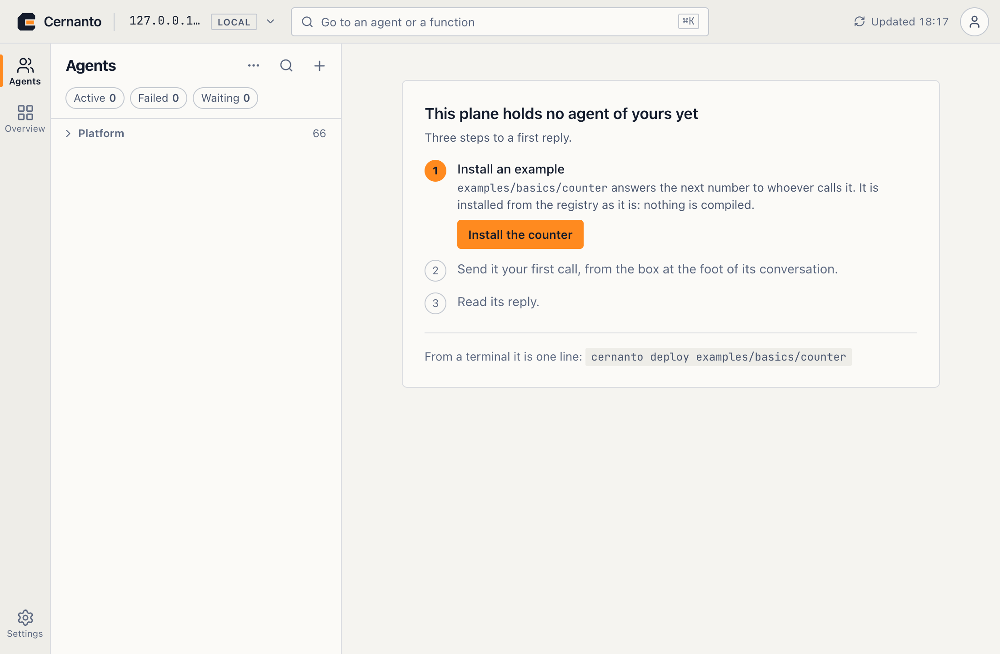
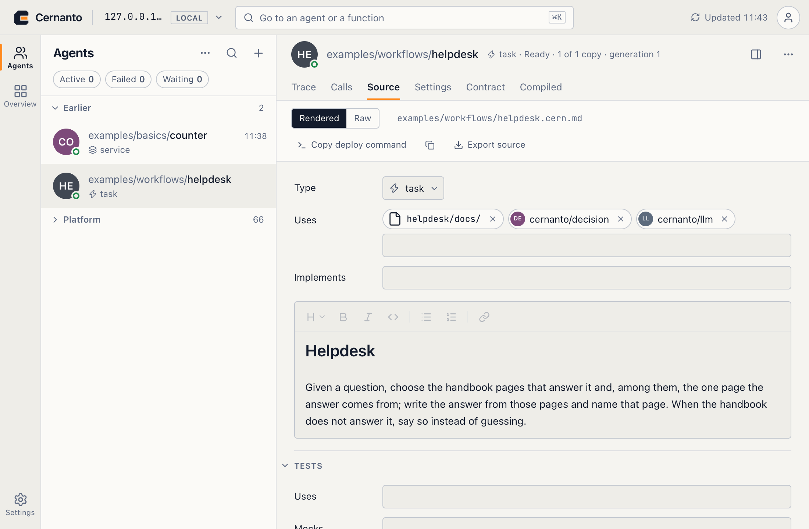
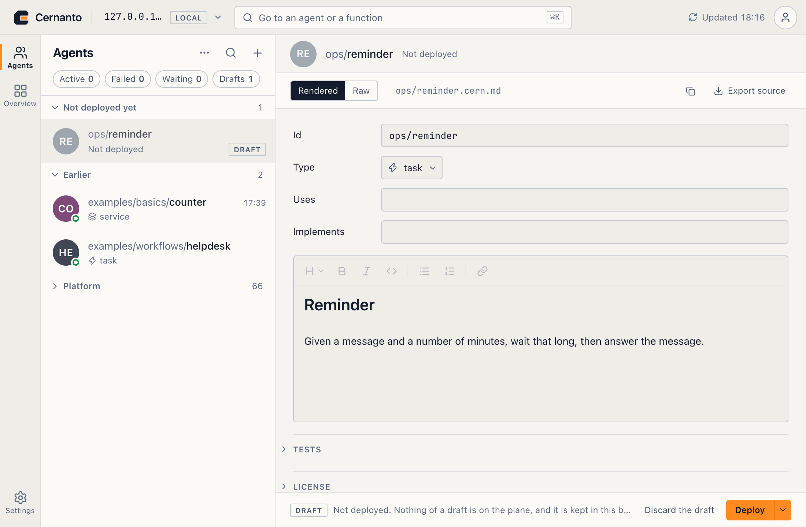

# The web UI

[Documentation](README.md) · [Project README](../README.md)

Every plane serves a web UI at its gateway's address: the plane's own screen, in a browser. It lists the agents, shows each call as a conversation, calls a function from a form, and shows an agent's source, contract and compiled code beside its settings. Everything it does is something the `cernanto` command does, so each part below names the command beside it.

## Open it

A plane runs on this machine first: the [Quickstart](../README.md#quickstart) installs Cernanto and starts one. Then one command opens that plane's UI in your default browser:

```bash
cernanto ui
```

`cernanto dev` prints the same address once the plane is up:

```text
the local plane is up: http://127.0.0.1:7434
open its UI in a browser: http://127.0.0.1:7434/ (or: cernanto ui)
park it with: cernanto dev down
```

The UI shows what the plane runs. After the [Quickstart](../README.md#quickstart) that is the examples you deployed. Select `examples/basics/counter` in the list of agents: the call you made is there, read as a conversation. Send it `next` again from the box at the foot of that conversation: press **Next**, and read the reply under it. A plane on another machine is reached as [On a server](#on-a-server) says.

## A plane with no agent yet

Open the UI before you deploy anything, and it offers three steps to a first reply:

1. **Install an example.** Press **Install the counter**. The plane installs `examples/basics/counter` from the registry as it is: nothing is compiled, and no model is asked.
2. **Send it your first call**, from the box at the foot of its conversation. The counter has one function, `next`, which takes nothing: press **Next**.
3. **Read its reply.** The first answer is `1`. Press again and it is `2`.



Any published agent is installed the same way: press **+**, choose **From the registry**, type its name, such as `examples/workflows/helpdesk`, and press **Install**. An agent installed this way runs as it was published, and the plane keeps it apart from the same agent deployed from a folder: read [Adding an agent](#adding-an-agent) before you deploy an example from a clone that you installed here.

## An agent's tabs

Choose an agent in the list. Its screen has six tabs, each beside the command that does the same:

| Tab      | What it shows                                                       | The command                                           |
| -------- | ------------------------------------------------------------------- | ----------------------------------------------------- |
| Trace    | A call as a conversation, and the box that calls a function         | `cernanto trace`, `cernanto call`                     |
| Calls    | The recent calls                                                    | `cernanto calls`                                      |
| Source   | The source the agent was compiled from, read and edited, and Deploy | `cernanto source`, `cernanto deploy`                  |
| Settings | Config, Auth and Traces                                             | `cernanto config`, `cernanto auth`, `cernanto traces` |
| Contract | What the agent does, and how to call each function                  | `cernanto contract`                                   |
| Compiled | The code and the tests the compile wrote                            | `cernanto compiled`, `cernanto tests`                 |

The Trace and Calls tabs show an agent's debug lines while its traces stand at debug, and where its traces are off they say so, with the way to Settings. The menu at the agent's head acts on the agent as a whole: Restart for a service or a job and Run for a worker (`cernanto restart`), Deploy again, the two exports below, and Delete (`cernanto delete`).



## Adding an agent

The **+** button has four ways. Each gives the agent one of two standings on the plane:

| The way             | What it does                                            | The agent's standing                              |
| ------------------- | ------------------------------------------------------- | ------------------------------------------------- |
| New agent           | Opens a draft in the editor, to write and deploy        | Deployed from a source, which lives on the plane  |
| From the registry   | Installs a published agent as it is, with what it needs | Installed                                         |
| From .cern.md files | Each source becomes a draft of a new agent, to deploy   | Deployed from a source, once you deploy the draft |
| From .cern packages | A compiled package runs as it is: nothing is compiled   | Installed                                         |

An installed agent runs as it was published: you read it, call it and watch it. An agent deployed from a source is yours to change. The two are two standings of one id, and a plane holds one of them. To take the other road with the same id, remove the agent first, from its menu or with `cernanto delete <id>`: the delete removes the agent with what it remembers and its traces, so the other road starts it fresh. The files of a published agent are got with nothing removed: `cernanto registry get <name>` brings them into a folder of yours.

## Writing an agent here

**New agent** opens a draft: its id, its type, what it works with and, in English, what it does. A draft is this browser's alone until it is deployed: nothing of it is on the plane, and another browser does not have it. **Deploy**, under the draft, compiles it with the plane's coding assistant, tests it and ships it, and the compile's log runs under the source. The arrow beside Deploy holds the command's other ways to deploy (`--no-verify`, `cernanto compile`, `--recompile`, `--new-contract`, `--fail-fast`) and **Dry run** (`--dry-run`), which says what a deploy would do: nothing is written, verified or shipped. One thing it does all the same: an agent the source uses that this plane does not run is installed from the registry first. On a deployed agent, **Diff** shows the draft against the deployed source, line by line.

A source deployed from here lives on the plane and in no repository. To keep it in git, take it to a folder:

- `cernanto source <id> --to <folder>` writes the source at the path its id names, with every file it names, so the folder reads as a workspace. It lays no package, so the next deploy from that folder compiles the agent.
- **Export source**, in the agent's menu, saves one file, `<name>.cern.md`. The files the source names are not in it.
- **Export package**, in the same menu, saves `<name>.cern`: the compiled package as it runs.
- **Export**, in the plane's Settings, saves one archive of every source of your agents, each at the path its id names. A source that names files is not whole without them.

Once a source is in a folder, change it there and deploy from there. The plane does not record where a source is kept, so keep one place for it.



## The plane

**Overview** is the whole plane on one screen: the AI cost and the calls active now, what needs a person (a login an agent waits for, an agent that failed), and the agents in the table `cernanto ls` prints, sorted by any column.

**Settings** holds what belongs to the plane and to no one agent: the plane's kind and your name for it, which stand at the top of every screen so that a call or a delete is not made on the wrong plane; the clock and the look; the coding assistant that compiles here and how it is credentialed; the operator tokens (`cernanto token`); every agent's config and accounts, a list each; the export of all sources; and links to your other planes.

## A module's function

A module runs inside the agents that use it, so its send box has **In** before the function: `by itself`, or one of the tasks, services and jobs that use it. The first call by itself starts the module as one service, listed as `<module>-standalone`, and the module's menu deletes it. [A module and its user](WRITING-AGENTS.md#a-module-and-its-user) has the rules.

## On a server

Every server's gateway serves the UI. The UI sends no token, so it works for a request made on the server itself: from your machine, open a tunnel to a server's own address, `ssh -o ExitOnForwardFailure=yes -L 7435:127.0.0.1:7434 <server>`, then `http://127.0.0.1:7435/` in your browser. The tunnel takes a local port of its own, since 7434 is the port of a plane on your own machine, and with that option `ssh` stops when it cannot take the port: the screen you open is the server's and never your own plane's. Reached any other way, it shows one screen that says it serves the machine the plane runs on. [Reaching the gateway from outside](RUNNING-A-PLANE.md#reaching-the-gateway-from-outside) has the rules.

## What the browser asks outside the plane

Two reads, each of a public list and with nothing of the plane in it: the Cernanto registry's packages, at `packages.cernanto.com`, for **From the registry** and for the agents a source can name; and npm's registry, for the package search in a source's grants, with what was typed there. Everything else the UI asks, it asks of the plane it was served by.

## Where it ends

The UI is a console for one plane, on that plane's machine. A draft is one browser's. A source deployed from here is on the plane until you take it to a folder. For a team, the folder in git stays the place where agents are written, reviewed and kept, and `cernanto deploy` the road from it: [Writing agents](WRITING-AGENTS.md) has that loop.

---

Copyright (c) 2026 Cernanto. This document is licensed under the Apache License, Version 2.0.
